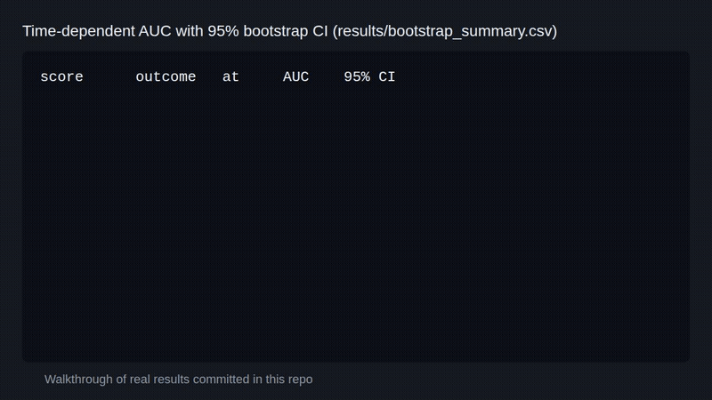

# Longitudinal validation of metabolic syndrome risk scores



Tests whether two metabolic syndrome risk scores predict death, using public US NHANES data.

[](https://github.com/jayhemnani9910/longitudinal-mets-validation/actions/workflows/test.yml)
[](LICENSE)

The GIF is a walkthrough of results already in `results/`, not a live run.

This is an external validation study. I take two published metabolic syndrome scores, RMRS (Shin et al. 2024, PeerJ CS) and the B9 decision tree (Shin et al. 2023, PLoS ONE), and test them on NHANES 1999 to 2018 linked to the public-use NHANES Linked Mortality File (2019 release). I compare them with the ACC/AHA Pooled Cohort Equations, Framingham 2008 and FINDRISC for cardiovascular, diabetes-related and all-cause mortality.

Project page: https://jayhemnani9910.github.io/longitudinal-mets-validation/
Manuscript draft: [`manuscript/main.pdf`](manuscript/main.pdf)

## Quick look

```bash
git clone https://github.com/jayhemnani9910/longitudinal-mets-validation.git
cd longitudinal-mets-validation
Rscript --no-init-file -e 'install.packages("testthat", repos = "https://cloud.r-project.org"); testthat::test_dir("tests/scores")'
```

That runs the unit tests for the five score implementations. The full pipeline is under [Reproducing](#reproducing).

## How it works

1. `scripts/01` downloads the NHANES tables with the `nhanesA` package. `scripts/02` downloads the public-use Linked Mortality File from the NCHS FTP site and parses it.
2. `scripts/03` keeps adults aged 20 to 79 with measured values for all five metabolic syndrome components and no prior cardiovascular disease or type 2 diabetes, then joins the mortality file on SEQN and keeps those eligible for linkage.
3. `scripts/04` computes the five scores. The score code is in `R/scores/`, with tests in `tests/scores/`.
4. `scripts/05` to `15` fit the models and write tables and plots to `results/`: survey-weighted Cox for all-cause death, Fine-Gray competing risks for cardiovascular and diabetes-related death, IPCW time-dependent AUC, decision curves, DeLong, IDI and NRI, an XGBoost ceiling, Table 1, calibration curves, subgroups, a B9 refit, and a 500-rep PSU-cluster bootstrap.

## Results

- **Cardiovascular and all-cause death.** The clinical equations win clearly. At 9.5 years Framingham 2008 reaches AUC 0.858 for cardiovascular death and 0.810 for all-cause death. RMRS reaches 0.660 and 0.600.
- **Diabetes-related death.** RMRS and FINDRISC are statistically indistinguishable at 14.5 years (RMRS 0.752, FINDRISC 0.770). The primary IPCW time-dependent delta-AUC is -0.020, with a within-stratum bootstrap 95% CI of -0.068 to +0.028. The lower bound is below the -0.05 margin, so non-inferiority is not established on the primary metric, and FINDRISC is numerically higher. A secondary binary-outcome DeLong delta was +0.013 (-0.043 to +0.063), reported for comparison only. Adding RMRS on top of FINDRISC still helps a little: continuous NRI 0.139 (0.047 to 0.267) and IDI 0.004 (0.001 to 0.009), both cluster-bootstrap CIs above zero. FINDRISC uses NHANES-derived family history, prediabetes and physical-activity items, not placeholders.
- **B9 decision tree.** I rebuilt the full 22-leaf tree from the paper's S1 ruleset and applied it with its native Korean feature scaling. RMRS beats it only modestly (primary IPCW delta-AUC +0.014 all-cause [0.000, 0.029], +0.029 cardiovascular [-0.003, 0.064], +0.060 diabetes-related [0.015, 0.110]). On a held-out split the transported tree reaches 0.764 for diabetes-related death, above RMRS at 0.735, and a US refit reaches 0.83. An XGBoost ceiling on the five components alone reaches 0.772 for diabetes-related death, and 0.828 with age and sex added. An earlier impression that RMRS dominates the tree came from a degraded three-value reconstruction of the published model.

| Item | Value |
|------|-------|
| Data | NHANES 1999 to 2018 + Linked Mortality File, 2019 public-use release |
| Cohort | 17,031 adults aged 20 to 79 (fasting subsample); 13,836 in the 1999 to 2014 cause-coded subcohort for cardiovascular and diabetes outcomes |
| Deaths | all-cause 806 (full cohort, 10-year cap), cardiovascular 173 (10-year cap), diabetes-related 77 (broadened definition, 15-year cap) |
| Scores | RMRS, B9 tree, ACC/AHA PCE, Framingham 2008, FINDRISC |

Full tables are in `results/*_summary.csv`. The bootstrap intervals are in `results/bootstrap_summary.csv`.

## Reproducing

R 4.3.3 with `renv` (lockfile checked in, `rms` pinned to 6.7-1 for R 4.3.3), and Python with `uv` for the XGBoost step (lockfile checked in).

```bash
make data         # download NHANES + LMF and build the cohort
make scores       # compute the five scores
make analyses     # all-cause Cox, cardiovascular and diabetes Fine-Gray, calibration
make dca          # decision curves, pairwise comparisons, XGBoost
make tables       # Table 1, calibration curves, subgroups, B9 refit
make bootstrap    # 500-rep PSU-cluster bootstrap CIs (slow, hours)
make manuscript   # build manuscript/main.pdf
make test         # score unit tests
```

`make all` runs everything except `bootstrap`. The raw data goes to `data/`, which is gitignored.

## Repository layout

```
scripts/      numbered pipeline, 01 to 15 (R, plus one Python script)
R/scores/     the five score implementations
R/utils/      NHANES loader, survey design and survival helpers
tests/scores/ testthat unit tests for the scores
results/      output tables and plots
manuscript/   LaTeX source and rendered PDF
prereg/       study protocol, analysis plan and literature scan
diagrams/     D2 source and SVG renders of the pipeline, layout and scoring
docs/         the GitHub Pages site
```

## Study protocol

The analysis plan is in [`prereg/osf-preregistration-draft.md`](prereg/osf-preregistration-draft.md): hypotheses H1 to H5, inclusion criteria, score implementations, outcome definitions, AUC horizons, decision curve thresholds and the planned sensitivity analyses. It is a written protocol kept in the repo with the code and results. It is not a timestamped prospective registration.

## Citation

If you build on this, please cite the two scoring papers and this validation.

- Shin HJ, Oh J, Shim SS. A robust metabolic syndrome risk score using triangular areal similarity. *PeerJ Computer Science*, 2024.
- Shin HJ, Oh J, Shim SS. Machine learning predictive model for metabolic syndrome prevention. *PLoS ONE*, 2023.
- Hemnani J. External longitudinal validation of metabolic syndrome risk scores for cardiovascular, diabetes, and all-cause mortality in the US NHANES Linked Mortality File. Manuscript in preparation, 2026.

`CITATION.cff` drives GitHub's "Cite this repository" button.

## Contributing

See [CONTRIBUTING.md](CONTRIBUTING.md).

## License

MIT for code (see [`LICENSE`](LICENSE)). CC-BY for figures and manuscript text.
